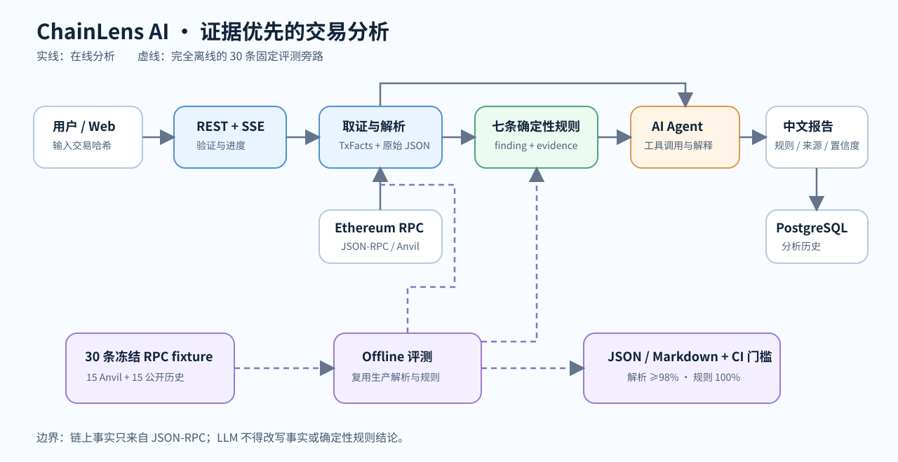
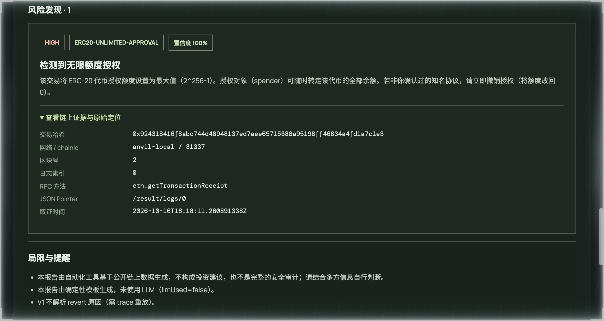
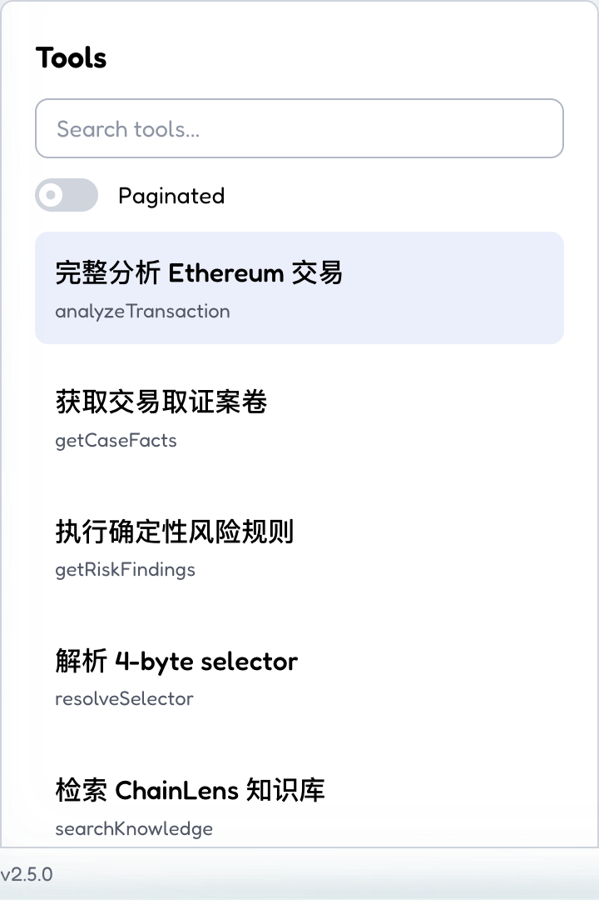
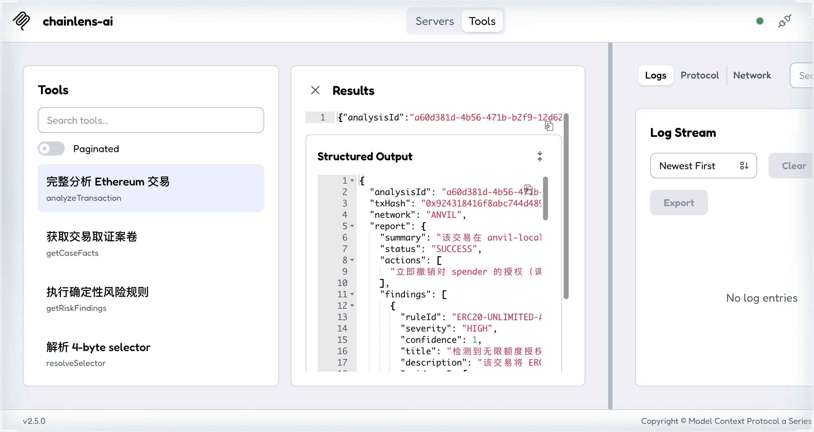
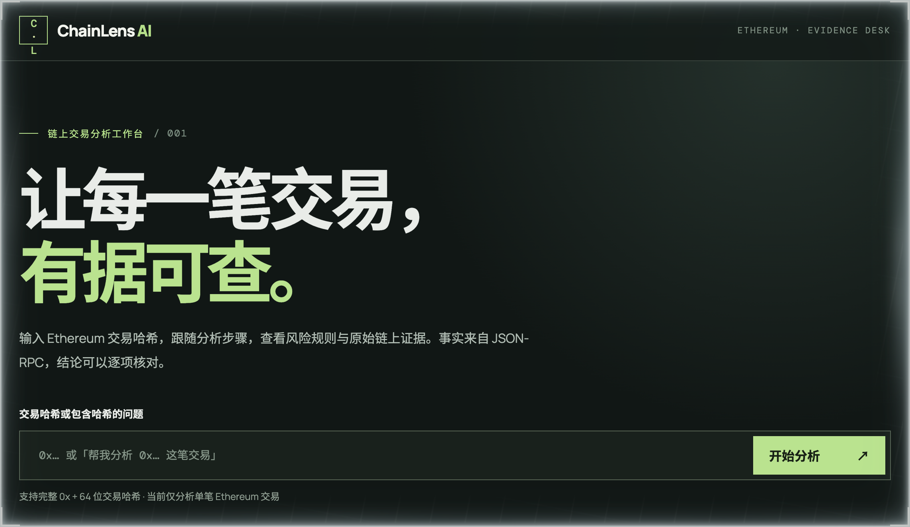
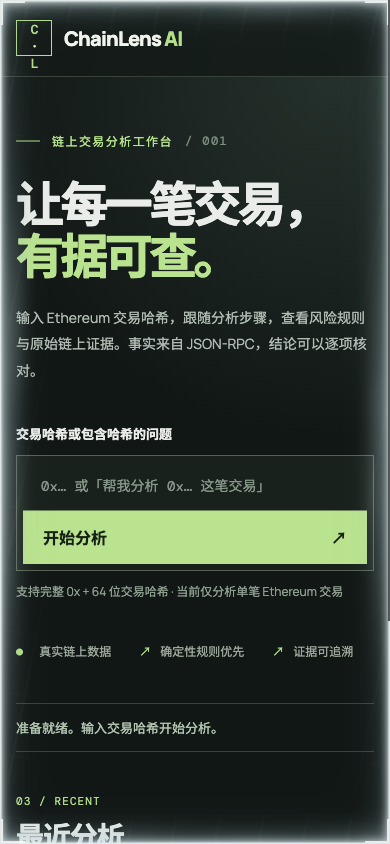

# ChainLens AI

基于证据的 Ethereum 链上交易分析 Agent：输入交易哈希，从 Ethereum JSON-RPC 取证，用确定性规则引擎判定风险，由 AI 生成带证据（evidence）、规则编号（ruleId）、置信度（confidence）的中文结构化分析报告。

> ⚠️ 本工具基于公开链上数据自动生成分析报告，**不构成投资建议，也不是完整的安全审计**。

## 当前状态

🚧 **开发中**。M0～M8 的工程能力已具备；M9 正在补齐交易评测与发布验收。现有能力包括 Ethereum JSON-RPC 取证与解析、7 条确定性风险规则、REST/SSE、中文降级报告、PostgreSQL 历史记录、OpenAPI、Anvil 本地演示、Agent 工具调用编排、受控中文知识库、Web 演示页和 MCP 五个只读工具。无 LLM Key 时返回 `llmUsed:false`、`degraded:true`，确定性链路仍可工作。设计与里程碑见 [设计文档.md](设计文档.md)。



[架构图源文件](docs/architecture.mmd)：在线取证走 Ethereum JSON-RPC 或本地 Anvil；离线评测回放冻结的 RPC 响应，复用同一套解析和规则代码，不请求外部节点。

## 快速开始

在 Apple Silicon Mac 上安装并启动 Docker Desktop，然后在仓库根目录运行：

```bash
./scripts/demo-up.sh
```

脚本使用 Compose 启动 PostgreSQL、Anvil 和应用，生成虚拟资产交易，并检查七条核心规则。成功后打开 <http://localhost:8080/>，从 `data/anvil-demo/transactions.json` 复制一个 `txHash` 到页面；[十分钟演示详解](#m410-分钟本地演示)包含命令行分析、换端口和停止方法。演示不用真实私钥、外部 RPC 或 LLM Key；没有模型 Key 时页面会明确标出“确定性降级报告”。

需要调整配置时，先参考 [`.env.example`](.env.example)：`ETH_RPC_URL` 只在不用本地 Anvil 时指定外部只读 RPC；`POSTGRES_*` 配置历史数据库；`DEEPSEEK_API_KEY` 只用于可选模型编排；`CHAINLENS_MCP_TOKEN` 为可选本地 MCP 访问令牌。密钥只放本机环境变量，不要提交到 Git。若 Docker 未启动或端口冲突，先看 `docker compose --profile demo-offline ps`，再按[本地演示排错](#m410-分钟本地演示)检查。

## M9 离线交易评测（当前可复现）

固定数据集包含 15 条可复现 Anvil 交易和 15 条公开主网历史交易。后者已冻结原始 JSON-RPC 响应，因此评测时**不需要联网、Docker、数据库或模型 Key**；它比较的是生产解析器和七条确定性规则，不让模型给自己打分。每条结论的 `ruleId`、`confidence`、证据方法及 JSON Pointer 都参与校验。

```bash
# 需要 Java 21+ 与 Maven 3.9+；不需要启动应用
mvn -B -ntp -P transaction-eval -pl chainlens-evaluation -am test \
  -Dtest=TransactionOfflineEvaluationGateTest \
  -Dsurefire.failIfNoSpecifiedTests=false
```

当前固定样本的机器结果是解析 **585/585**、规则 **210/210**（TP=18、TN=192、FP=0、FN=0）；门槛分别为 ≥98% 和 100%。这仅说明当前 30 条样本通过，**不等于对所有链上交易都达到 100% 准确率**。完整数字以 [JSON 报告](eval/results/offline/latest.json) 和 [可读报告](eval/results/offline/latest.md) 为准；[数据集清单](eval/cases/transaction-eval-v1.json) 列出来源和 ground truth。默认 `mvn verify` 不重复跑这项门槛，GitHub Actions 使用独立 `transaction-offline-evaluation` job；[2026-10-19 的远端 CI 运行](https://github.com/tylmcy/ChainLens-AI/actions/runs/39192303469) 已确认三个 job 全绿且上传了离线 artifact。故意改坏临时副本的排错方法见 [M9 验证记录](openspec/changes/m9-evaluation-release/verification.md)。Full 真实模型评测尚未验收，不能据此宣称 M9 整体结束。

### M9 Full 模型评测（显式启动，当前未验收）

Full 模式对同一数据集调用真实 `AnalysisService`，除解析和规则外还记录工具调用成功率、事实一致率、RPC/解析/规则/LLM/端到端延迟，以及模型 usage 与费用。它**不在默认 CI 中运行**，需要本地显式设置 `evaluation-full` profile，或由仓库维护者手动启动 [Full evaluation workflow](.github/workflows/full-evaluation.yml)。手动工作流必须填写预算、输入/输出单价、价格核对日期、模型上下文上界及官方来源；`DEEPSEEK_API_KEY` 和只读 `ETH_MAINNET_RPC_URL` 从 GitHub secrets 读取。先通过 `case_ids` 只选一笔 Anvil 交易冒烟；留空才运行完整 30 条，同时需要 Anvil 和主网两个正确的 RPC。报告上传为 `transaction-full-evaluation` artifact；预算不足、usage 缺失或模型异常会明确失败，不会伪装为通过。

DeepSeek 的旧模型名 `deepseek-chat` 已退役；本项目当前默认 `deepseek-flash`，既有本机 `.env` 也需同步检查 `DEEPSEEK_MODEL`。运行前按 [DeepSeek 官方模型与价格页](https://api-docs.deepseek.com/quick_start/pricing/) 重新核对上下文长度和峰值单价。使用 Ollama 作本地 provider 替换验收时，需自行准备支持工具调用的聊天模型，并显式设置 `SPRING_AI_MODEL_CHAT=ollama`；本地模型的 API 费用记为零，不代表电费或硬件成本为零。一次真实的 [Ollama 与 DeepSeek 同交易对照](docs/M9-Ollama-对照.md)和 Full 的验收状态见 [M9 验证记录](openspec/changes/m9-evaluation-release/verification.md)。

如果以 M9 作为学习项目，工程验收之后请再按 [M9 学习验收清单](docs/M9-学习验收.md) 独立解释、复现、修改和排错；自动测试不会替你完成学习验收。

一笔本地无限授权交易的实际 API 输出解读见 [M9 Anvil 示例报告](docs/M9-Anvil-示例报告.md)。



## M8 MCP Server

MCP 可以理解为“AI 客户端调用 ChainLens 的标准插座”。ChainLens 对外只暴露五个只读工具，不能读私钥、签名、广播交易或写链：

| 工具 | 用途 | 主要边界 |
|---|---|---|
| `analyzeTransaction` | 返回完整中文报告 | 事实来自 RPC，finding 来自规则，MCP 不写历史 |
| `getCaseFacts` | 查 transaction、receipt、block、事件和 calldata | 不调用 LLM 生成事实 |
| `getRiskFindings` | 重新取证并执行风险规则 | 不允许 LLM/RAG 新增 finding |
| `resolveSelector` | 查询 4-byte selector 候选签名 | 碰撞时返回全部候选，不武断唯一解 |
| `searchKnowledge` | 检索受控中文知识库 | 只能解释概念，不能证明当前交易事实 |

五个工具的最小输入示例：

```text
analyzeTransaction {"txHash":"0x<64 位十六进制>"}
getCaseFacts      {"txHash":"0x<64 位十六进制>"}
getRiskFindings   {"txHash":"0x<64 位十六进制>"}
resolveSelector   {"selector":"0x095ea7b3"}
searchKnowledge   {"query":"ERC20-UNLIMITED-APPROVAL"}
```

### Streamable HTTP（主传输）

先启动本地 Anvil、PostgreSQL 和应用：

```bash
./scripts/demo-up.sh
```

MCP 端点是 `http://127.0.0.1:8080/mcp`。它和 `POST /api/v1/analyses` 的业务 SSE 不是一回事：前者传输 MCP JSON-RPC 的 initialize、tools/list 和 tools/call，后者只是页面展示分析进度的事件流。

用官方 MCP Inspector CLI 列出工具（首次需下载 npm 包）：

```bash
npx --yes @modelcontextprotocol/inspector@2.5.0 --cli \
  --transport http \
  --server-url http://127.0.0.1:8080/mcp \
  --method tools/list
```

首次运行 Inspector 2.5.0 会下载它的 Web/CLI 依赖，在 Apple Silicon 上可能数分钟没有明显输出；只要 npm 仍在下载，就不是 ChainLens `/mcp` 故障。下面命令是一个不需要交易哈希的固定调用：

```bash
npx --yes @modelcontextprotocol/inspector@2.5.0 --cli \
  --transport http \
  --server-url http://127.0.0.1:8080/mcp \
  --method tools/call \
  --tool-name resolveSelector \
  --tool-arg selector=0x095ea7b3
```

图形 Inspector：

```bash
npx --yes @modelcontextprotocol/inspector@2.5.0 --web \
  --transport http \
  --server-url http://127.0.0.1:8080/mcp
```

Cursor 项目级配置见 [`docs/mcp/cursor-http.example.json`](docs/mcp/cursor-http.example.json)：把内容复制到 `.cursor/mcp.json`，再在 Cursor 的 MCP 工具页确认 `chainlens` 连接成功。仓库不直接提交 `.cursor/mcp.json`，避免未来误放真实 Token。

### DeepSeek Harness（本地 stdio）

先构建 jar，运行时需要本机 `127.0.0.1:5432` 的 PostgreSQL 和 `127.0.0.1:8545` 的 Anvil/RPC：

```bash
docker compose --profile demo-offline up -d postgres anvil demo-seed
mvn -B -pl chainlens-app -am package -DskipTests
```

把 [`docs/mcp/deepseek-harness-stdio.example.json`](docs/mcp/deepseek-harness-stdio.example.json) 中的占位绝对路径改成你本机的 `scripts/start-mcp-stdio.sh`，再将该 server 配置合并到 DeepSeek Harness 的本地 MCP 配置。DeepSeek Harness 是 M8 的本地 stdio 验收客户端；stdio 不占用 8080 端口，日志走 stderr，stdout 只保留给 MCP 协议。当前里程碑不做客户端打包，也不建立公网 Connector。

### 可选 Token 与排错

HTTP MCP 默认只监听 `127.0.0.1`。可以设置 `CHAINLENS_MCP_TOKEN`，客户端则发送 `Authorization: Bearer <token>`；它只是本机/受信网络的轻量保护，不是 OAuth 或公网部署方案。Docker 容器内显式使用 `0.0.0.0`，是为了让宿主端口映射可达，不代表已授权暴露公网。

- `401` / `UNAUTHORIZED`：已启用 Token，但客户端没有发送正确 Bearer Token。
- `INVALID_INPUT`：`txHash` 必须是 `0x` + 64 位十六进制，selector 必须是 `0x` + 8 位。
- `TRANSACTION_NOT_FOUND`：当前 RPC 找不到该交易；先确认网络和交易哈希是否匹配。
- `RPC_UNAVAILABLE`：检查 Anvil/RPC 地址、容器健康状态和网络。
- `TOO_MANY_REQUESTS`：并发分析达上限，稍后重试；REST、业务 SSE 和 MCP 共用该上限。
- `KNOWLEDGE_UNAVAILABLE`：RAG 关闭、未就绪或故障；确定性交易分析仍可用。

固定 Anvil 操作、调用示例和脱敏输出见 [M8 MCP 演示](docs/M8-MCP-演示.md)；学习时请完成 [M8 学习验收清单](docs/M8-学习验收.md)。





## M7 RAG 知识库

大白话说，RAG 是“先从项目自己的中文说明书里找最相关的三段，再让 AI 用这些段落解释风险”。它不是链上取证：交易状态、地址、金额、finding、ruleId、confidence 和 evidence 仍只能来自 JSON-RPC 与确定性规则。报告中的 `CHAIN` 来源证明当前交易事实，`KNOWLEDGE` 来源只解释概念，而且只能引用本次 `searchKnowledge` 工具实际返回过的文档片段。

RAG 默认关闭，所以普通 `mvn verify`、`demo-offline` 和十分钟演示不会下载模型。关闭或故障时，`NoopKnowledgeSearch` 会明确返回不可用，交易解析和规则报告继续工作。

本地启用步骤：

```bash
# 1. 启动 pgvector（也可复用已运行的 demo-offline PostgreSQL）
docker compose --profile demo-offline up -d postgres

# 2. 首次运行会下载约 95 MB 的 BGE-small-zh-v1.5 单文件 ONNX 模型
#    以及 DJL 在 macOS arm64 上进行张量计算所需的一次性 CPU 原生库
SPRING_PROFILES_ACTIVE=rag-local \
SPRING_AI_MODEL_EMBEDDING=transformers \
CHAINLENS_KNOWLEDGE_ADMIN_ENABLED=true \
mvn -pl chainlens-app -am spring-boot:run

# 3. 可选：从本机手动触发一次固定知识目录同步；端点不接受路径或 URL
curl -X POST http://127.0.0.1:8080/api/v1/knowledge/sync
```

默认模型缓存目录是 `.cache/chainlens/onnx`，可用 `CHAINLENS_EMBEDDING_CACHE_DIR` 改到持久目录；DJL 原生库另外缓存在用户目录的 `.djl.ai`。这些缓存和模型二进制都不会提交 Git。模型与 tokenizer 地址也可分别用 `CHAINLENS_EMBEDDING_MODEL_URI`、`CHAINLENS_EMBEDDING_TOKENIZER_URI` 覆盖，包括指向已下载文件的 `file:/absolute/path/model.onnx`。管理端点默认不存在，只有显式设置 `CHAINLENS_KNOWLEDGE_ADMIN_ENABLED=true` 后才注册，并且只接受 loopback 请求。

真实检索评测使用 12 条版本化中文问句，其中 10 条有目标来源、2 条无关查询：

```bash
CHAINLENS_EMBEDDING_CACHE_DIR=.cache/chainlens/onnx \
mvn -P rag-eval -pl chainlens-evaluation -am test \
  -Dtest=RagRetrievalEvaluationTest \
  -Dsurefire.failIfNoSpecifiedTests=false
```

结果写入 `eval/results/rag/`，当前锁定阈值 `0.50` 的本地真实结果是 10/10 定向问句 Top-3 命中，2 条无关查询均被过滤。若模型下载卡住或留下 0 字节缓存，先检查 Hugging Face 大文件访问，必要时用 `curl -L` 手动下载后通过上述 `file:` URI 覆盖，而不是先怀疑 Docker；若报 `publish.djl.ai` 错误，是首次下载 DJL `osx-aarch64` CPU 原生库未完成；若报 pgvector 表或扩展错误，确认镜像是项目固定的 `pgvector/pgvector:0.8.6-pg17-bookworm`；若搜索返回 `NOT_READY`，表示启动后的后台同步尚未完成。学习时请完成 [M7 学习验收清单](docs/M7-学习验收.md)，不要只以测试通过判断自己已经掌握。

## M6 Web 演示页

页面入口：启动本地演示后访问 <http://localhost:8080/>。输入 `data/anvil-demo/transactions.json` 中任意 `txHash`，可查看 SSE 分析步骤、交易摘要、风险规则、证据的 RPC 方法和 JSON Pointer，以及最近分析。浏览器只保存最近 10 条分析 ID 索引；完整报告保存在 PostgreSQL。页面会明确标出 LLM 未启用时的“确定性降级报告”。

已用真实 Anvil 交易在浏览器走通“输入 → SSE 时间线 → 报告 → 展开原始证据 → 历史恢复”；桌面 1280px 与窄屏 390px 下均无横向溢出。以下截图展示初始页面，报告请用本地演示数据亲自生成。





本地开发需要 Java 21、Node 22 和 pnpm 11.9.0：

```bash
# 终端 1：先启动后端及 Anvil/PostgreSQL，或使用下方 Docker 演示
./scripts/demo-up.sh
# 终端 2：前端热更新，代理 /api 到 localhost:8080
cd web
pnpm install --frozen-lockfile
pnpm dev
```

前端验证与单一 Boot 制品：

```bash
cd web && pnpm typecheck && pnpm test && pnpm build
cd ..
mvn -pl chainlens-app -am -Pweb package
```

`-Pweb` 需要宿主机有 pnpm；默认 `mvn verify` 不调用 Node。Docker 完整构建自带固定 Node 22.23.2 阶段，不要求 Mac 安装 Node。若页面无法加载，先检查 `docker compose ps` 和 `http://localhost:8080/actuator/health`；若分析返回 RPC 错误，确认 Anvil 已就绪并使用本地演示交易哈希。若历史条目失效，可在页面移除本地索引；这不会删除数据库记录。

如果你把 M6 当作学习项目，请按 [M6 学习验收清单](docs/M6-学习验收.md) 自己解释、修改、复现和排错；自动测试通过不代表这些技能已经掌握。

## M5 Agent 编排

- 设置 `SPRING_AI_MODEL_CHAT=deepseek` + `DEEPSEEK_API_KEY` 后自动启用 LLM 编排；项目会将后者映射到 Spring AI 的 `spring.ai.deepseek.api-key`（否则走确定性降级链路）；
- 工具调用步骤随 `tool_steps` 字段返回，SSE 直播 `tool.started` / `tool.completed` 事件；
- 护栏：强制取证 → 上下文装配 → 事实一致性校验 → Schema 校验+重试+降级；
- 指标：`/actuator/metrics`（如 `chainlens.tool.calls` 成功率）。

## M3 接口与验证

- `POST /api/v1/analyses`：同步 JSON；请求头 `Accept: text/event-stream` 时返回 SSE 进度。
- `GET /api/v1/analyses/{id}`：查询历史分析。
- `GET /api/v1/analyses/{id}/stream`：重放历史时间线。
- `/swagger-ui.html`、`/v3/api-docs`：OpenAPI 文档。

使用 Java 21 运行完整验证（默认排除需要真实模型或 API Key 的 `smoke` 测试）：

```bash
mvn verify
```

只运行 PostgreSQL/Testcontainers 测试：

```bash
mvn verify -Dgroups=db
```

## M4：10 分钟本地演示

你只需要安装并启动 Docker Desktop。**不需要在 Mac 上安装 Foundry、Anvil、PostgreSQL、Java 或 Node**；Compose 会使用固定版本的 ARM64 镜像，适配 Apple Silicon。

首次运行需要联网下载镜像和 Maven 依赖，之后同一版本可复用 Docker 缓存。演示运行时不访问外部 Ethereum RPC，也不需要 LLM Key。

```bash
./scripts/demo-up.sh
```

脚本会完成四件事：启动 PostgreSQL 17 + pgvector、启动内存中的 Anvil 本地链、生成 15 笔覆盖 7 条规则及边界值的测试交易、启动 ChainLens 并验收 7 条核心规则。成功时会看到：

```text
M4 演示验收通过：7 条规则均由真实 Anvil 交易触发。
```

如果本机 `8080` 已被其他项目占用，换一个端口即可，不用停止原项目：

```bash
CHAINLENS_PORT=18080 ./scripts/demo-up.sh
```

也可以不用封装脚本，直接启动 Compose profile：

```bash
docker compose --profile demo-offline up --build -d
./scripts/demo-verify.sh
```

### 看懂演示数据

启动后，`data/anvil-demo/transactions.json` 会列出 15 个场景的交易哈希和预期规则；若本机文件未生成，可先看评测集中的固定 Anvil 样本。任选一个哈希请求 API：

```bash
TX_HASH=$(sed -n 's/.*"txHash":"\([^"]*\)".*/\1/p' data/anvil-demo/transactions.json | head -1)
curl -s -H 'Content-Type: application/json' \
  -d "{\"txHash\":\"$TX_HASH\"}" \
  http://localhost:8080/api/v1/analyses
```

- API：<http://localhost:8080/api/v1/analyses>
- Swagger：<http://localhost:8080/swagger-ui.html>
- Anvil JSON-RPC：<http://localhost:8545>
- PostgreSQL：`localhost:5432`

这里使用的是 Anvil 默认公开测试账户和虚拟 ETH，只存在于本机内存链。脚本通过节点解锁账户发送交易，仓库里没有私钥、助记词或真实资产。

停止容器并保留数据库历史：

```bash
docker compose --profile demo-offline down
```

同时清空本地演示数据库：

```bash
docker compose --profile demo-offline down -v
```

如果 Docker Desktop 注入了指向 `127.0.0.1` 的代理，Compose 已为容器间的 `anvil`、`postgres`、`chainlens-app` 通信配置 `NO_PROXY`，无需为了本项目反复修改全局代理。

### 演示数据如何生成

源码位于 `scripts/anvil-demo/src/DemoTransactions.sol`，固定字节码由官方 `ethereum/solc:0.8.30` 生成。只有修改合约源码后才需要重建字节码：

```bash
./scripts/anvil-demo/build-bytecode.sh
```

## 技术栈

Java 21 · Spring Boot 4.1 · Spring AI 2.0 · PostgreSQL + pgvector · Anvil · Vite

## 许可证

Apache-2.0，见 [LICENSE](LICENSE)。
